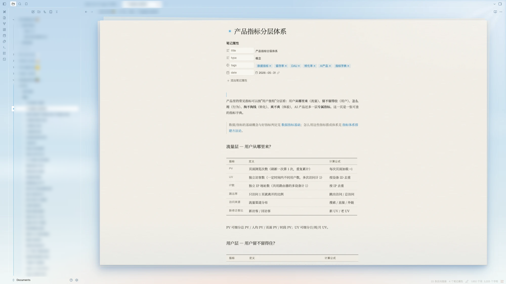
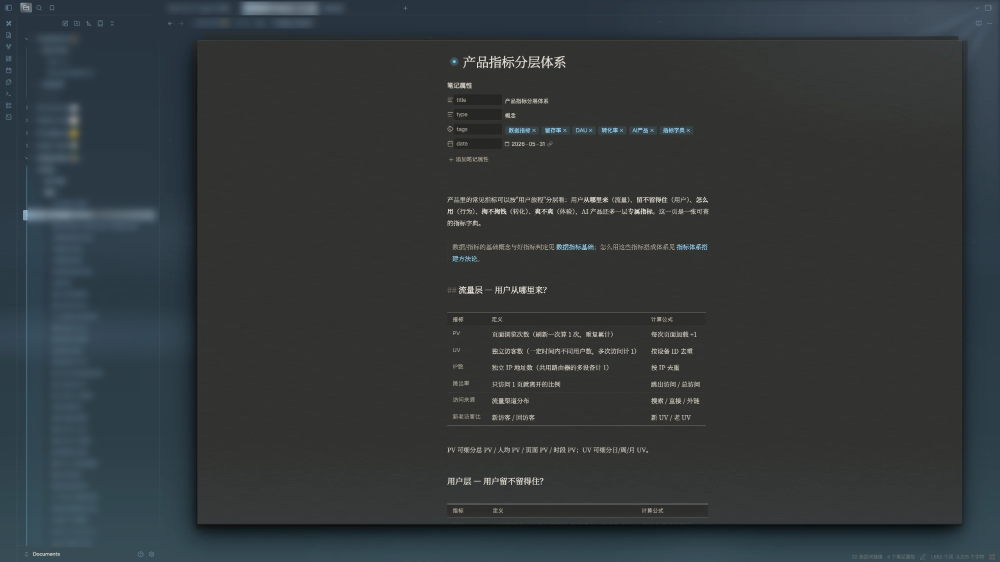
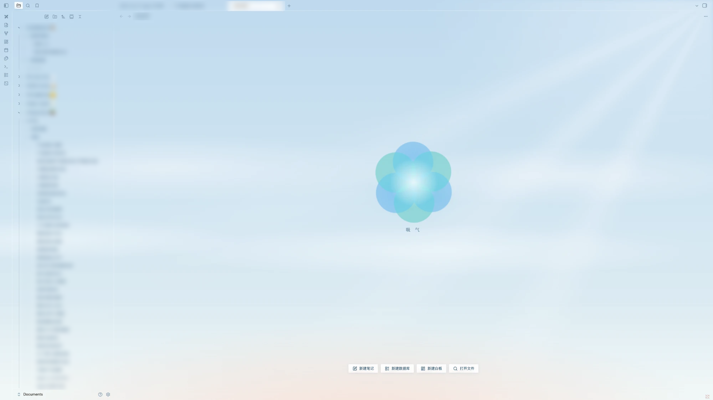

# Byrcen Breathe

一张暖纸，浮在清晨淡蓝天光里的几层雾上，天光和雾在慢慢呼吸。
为专注写作和安静思考而做的 Obsidian 主题。

*A warm sheet of paper floating on layers of morning mist — and the sky breathes, slowly.
An Obsidian theme for focused writing and quiet thinking.*

---

## 特色 · Features

**天光与雾 · Sky and mist**
窗口是一片有纵深的天空：远处的天、几层缓慢飘动的雾、右上角一团光和几道柔和的光束。白天有地平线的晨曦，夜里有星星和月光。

*The window is a sky with depth — distant gradient, drifting layers of mist, a glow with soft light beams. Dawn on the horizon by day; stars and moonlight by night.*

**一张会呼吸的纸 · A breathing sheet of paper**
写字的地方是一张暖色的纸，带细微的纸纹、被天光照亮的一角、有厚度的边缘，身后还压着一叠纸。纸随呼吸轻轻浮起。

*You write on warm paper with fine grain, a corner lit by the sky, a sense of thickness, and a small stack behind it. It lifts gently with each breath.*

**呼吸 · Breathing**
天光、雾、标题前的光点，全都按同一个节奏呼吸（默认 10 秒一次，一分钟六次）。新标签页是一朵呼吸花，可以跟着它做几轮呼吸练习。

*The sky, the mist, and the light dot before each title all breathe to one rhythm (10 s by default — six breaths a minute). The new tab is a breathing flower you can follow for a few rounds.*

**液态玻璃 · Liquid glass**
侧栏、标签页、按钮、菜单都是浮在天光上的玻璃，边缘有随光的高光。

*Sidebars, tabs, buttons and menus are glass resting on the sky, with light-catching edges.*

**细节 · Details**
- 书页式表格：只有横线，上下两道粗线，表头小字。*Book-style tables.*
- 文件列表：一级文件夹用宋体，层级线是两头淡出的光丝，当前文件所在的路径会亮起来。*Serif top-level folders, light-thread guides, and the path to the current file lights up.*
- 3px 微圆角，克制的配色：蓝只用在「光」上。*3 px corners; blue is reserved for light.*
- 亮色、暗色都认真做过，跟随系统切换。*Carefully tuned light and dark modes.*

---

## 设置 · Settings

装上 [Style Settings](https://github.com/obsidian-community/obsidian-style-settings) 插件后，设置里会出现「Byrcen Breathe」面板。没装也能用，所有效果默认都开着。

*Install the [Style Settings](https://github.com/obsidian-community/obsidian-style-settings) plugin to get a "Byrcen Breathe" panel. Without it, everything works with defaults.*

| 分组 Group | 选项 Options |
|---|---|
| 视觉效果 Effects | 晨曦与星空、光束与浮尘、液态玻璃、纸的光影、雾层、身后一叠纸、纸纹、纸边淡出、侧栏署名、所有呼吸动效 |
| 文件列表 File list | 一级文件夹宋体、光丝层级线、路径高亮、展开淡入、数字等宽、纪念日发光 |
| 写作 Writing | 专注模式（打字时其他段落变淡）*Focus mode* |
| 呼吸 Breathing | 呼吸一次的秒数（4–20 s）、每轮呼吸几次、一直呼吸 *Breath length, breaths per round, loop forever* |
| 微调 Tuning | 呼吸花大小、雾的浓度、纸四周留白 *Flower size, mist strength, paper margin* |

系统开启「减弱动态效果」时，所有动画会自动停下。
*All animation stops when "Reduce motion" is on in your system settings.*

## 字体 · Fonts

正文推荐 [思源宋体 Noto Serif SC](https://fonts.google.com/noto/specimen/Noto+Serif+SC)（免费开源）。没装的话会退回系统宋体和 Georgia。界面字体用系统的苹方 / system-ui。

*Body text is designed for [Noto Serif SC](https://fonts.google.com/noto/specimen/Noto+Serif+SC) (free). Without it, the theme falls back to the system serif and Georgia.*

## 小提示 · Tips

- macOS 上建议把「设置 → 外观 → 窗口框架样式」设成「隐藏框架」，天空能一直铺到窗口最顶。
  *On macOS, set Appearance → Window frame style to "Hidden" so the sky reaches the top edge.*
- 「设置 → 编辑器 → 可读行宽」打开时，文字栏居中、宽度适合阅读。
  *Keep "Readable line length" on for a comfortable text column.*

## 许可 · License

[MIT](LICENSE) © 2026 Byrcen
